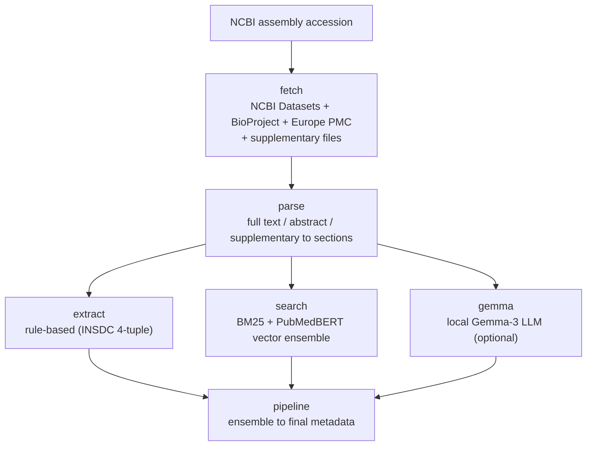
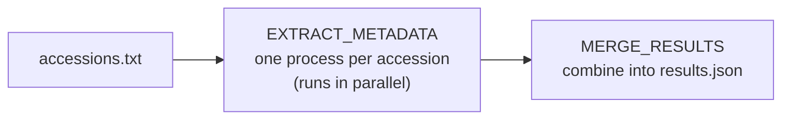

# Google Summer of Code 2026: Work Product Submission

- **Name:** Soomin Lee
- **Project:** Literature-based genome-assembly metadata extraction
- **Organization:** [EMBL-EBI (Ensembl)](https://www.ensembl.org)
- **Mentors:** Jorge Alvarez, Disha Lodha
- **Technologies:** Python, NCBI / Europe PMC APIs, NLP retrieval (BM25 + PubMedBERT embeddings), a local LLM (Gemma-3), Nextflow

This summer I built a pipeline for the Ensembl GenomIO project that recovers
biological metadata for a genome assembly directly from its scientific
literature. Given only an NCBI assembly accession, the pipeline finds the
assembly's publication, reads it, and extracts the assembly's **ploidy, sex, and
cultivar/strain** (alongside species and chromosome number), attaching an
evidence trail to every value so that a curator can review it. The work is
contributed upstream as a new `ensembl.io.genomio.literature` subpackage.

## 1. Background

The INSDC archives (ENA / NCBI / DDBJ) require only one attribute for every
sample: its taxonomic identity. Biologically important attributes such as
**ploidy, cultivar, and sex** are, under most submission packages, optional or
absent from the form entirely, so an assembly can receive an accession while
carrying none of them, even though those values are usually stated precisely in
the accompanying publication's Materials and Methods. The result is a large,
systematic metadata gap in the archive: the information exists, but in prose
rather than in structured fields.

## 2. Motivation and project goals

Ensembl needs this metadata to build accurate gene-tracking and comparative
resources, and manual curation across thousands of assemblies does not scale.
The goals of the project were to:

- **Recover the missing metadata from the primary literature** given an assembly
  accession, focusing on plant ploidy as the hardest and most valuable case.
- **Keep every value auditable** by attaching an evidence quote, method and
  confidence, so results can be reviewed rather than blindly trusted.
- **Abstain rather than guess** when the paper contains no evidence.
- **Package the result for Ensembl** so it can be integrated into `ensembl-genomio`.

## 3. Work done

### 3.1 The pipeline

The pipeline is a chain of modules, each doing one job:

- **`fetch`** resolves the assembly (NCBI Datasets) and finds its publication
  through linked PMIDs, Entrez elink, BioProject, and Europe PMC name /
  full-text-species / Entrez searches, ranking candidates with a relevance
  scorer.
- **`parse`** turns full-text XML, abstracts, and **supplementary files**
  (docx / xlsx / csv / html) into weighted sections and chunks.
- **`extract`** applies rule-based extraction, encoding ploidy as the INSDC
  4-tuple `[level, mechanism, irregular, derivation]` plus chromosome number.
- **`search`** runs a hybrid BM25 + PubMedBERT vector-search ensemble that votes
  alongside the rule extractor.
- **`gemma`** is an optional, grounded local Gemma-3 LLM layer (off by default)
  that adds a third vote and contributes sex and strain/cultivar.
- **`pipeline`** orchestrates the above and produces the final metadata record.

A guiding principle throughout is **grounded, abstaining extraction**: every
value carries its supporting evidence, and the pipeline returns `null` rather
than inventing an answer when the text is silent.

### 3.2 Orchestration and packaging

- A **Nextflow** workflow (`pipelines/nextflow/`) runs one process per accession
  with parallelism, automatic retries for transient API errors, and result
  merging, replacing a sequential batch loop and giving roughly a 3x speed-up.
- The code was restructured into the **`ensembl.io.genomio.literature`**
  namespace package with a `literature_metadata` console entry point and a
  `literature` optional-dependencies group, so it drops directly into
  `ensembl-genomio`.

### 3.3 Pull request

| Pull request | Description | Status |
|---|---|---|
| [Ensembl/ensembl-genomio#519](https://github.com/Ensembl/ensembl-genomio/pull/519) | Add literature-based genome-assembly metadata extraction module | Open (under review) |

All development history, the benchmark, the robustness sweep, and the Nextflow
workflow live in the GSoC development repository:
**[soominhildelee/gsoc-genome-metadata](https://github.com/soominhildelee/gsoc-genome-metadata)**.

### 3.4 Results and current state

**Curated benchmark:** 11 / 11 assemblies pass with the full pipeline
(10 / 11 with rule + vector only; the last needs the LLM layer to resolve
diploid-ancestor confounding).

**Scale test on 1,059 arbitrary plant assemblies** (measures robustness and
coverage, not accuracy, since there is no ground truth):

| Metric | Result |
|---|---|
| Assemblies processed | 1,059 |
| Unhandled crashes | **0** |
| Species extracted | 1,047 / 1,059 (98%) |
| Ploidy recovered (all paper-grounded) | 713 / 1,059 (67%) |
| Sex identified | 164 / 1,059 |
| Cultivar / strain found | 391 / 1,059 |

**Ploidy distribution** (of the 713 assemblies where ploidy was found), a
biologically sensible spread from haploid to decaploid:

| Ploidy | Count | |
|---|---:|---|
| L2 diploid | 467 | ██████████████████████████████ |
| L4 tetraploid | 162 | ██████████ |
| L6 hexaploid | 47 | ███ |
| L3 triploid | 16 | █ |
| L8 octoploid | 11 | ▊ |
| L10 decaploid | 5 | ▍ |
| L1 haploid | 3 | ▎ |
| L5 pentaploid | 2 | ▏ |

Two follow-up fixes (a parse fallback and a binomial/genus search fallback)
recovered 21 of the 33 previously-incomplete assemblies in that sweep.

## 4. Challenges faced

- **Polyploidy confounding.** In a polyploid genome paper the diploid *ancestor*
  species are named more often than the target organism, so naive keyword
  counting fails. This motivated the grounded + ensemble + abstaining design.
- **Retrieval is the hard part.** Two cases were especially instructive:
  - *Cotton:* the relevance scorer initially ranked a paper titled "Draft genome
    of *Bacillus* ... isolated from cotton" first, because it names the host.
    Fixed with a host-context penalty that treats the target-as-habitat like an
    organelle paper.
  - *Agapanthus:* the correct ploidy (2n = 4x = 30) is stated only in the full
    text of an open-access paper about a *different* genus. Fixed with full-text
    aware retrieval plus a confirmation pass that verifies the binomial actually
    appears before trusting the source.
- **Namespace packaging.** Integrating into `ensembl.io.genomio` required PEP 420
  namespace packages and relative imports so the subpackage merges cleanly with
  the existing installed package instead of shadowing it.
- **Scaling.** Wrapping the pipeline in Nextflow turned a multi-hour sequential
  run into a parallel one that scales by configuration rather than by code.

## 5. What is left to do

- Take the upstream pull request (#519) through review and merge.
- Add unit tests under the `ensembl-genomio` pytest conventions.
- Build a curated gold-standard set to report precision/recall (the scale test
  measures robustness and coverage, not accuracy).
- Recover the remaining "no paper found" cases where a publication genuinely does
  not yet exist (out of scope of retrieval).

I plan to continue contributing to Ensembl beyond GSoC to see this module
reviewed, tested, and merged.

## 6. Acknowledgment

I am sincerely grateful to my mentors, **Jorge Alvarez** and **Disha Lodha**, for
their guidance, code reviews, and patience throughout the project, and to the
Ensembl / EMBL-EBI team for their support. I would also like to thank **Google
Summer of Code** for the opportunity to contribute to a project with real impact
on genome data curation.

Thanks and regards,
Soomin Lee
Google Summer of Code 2026
